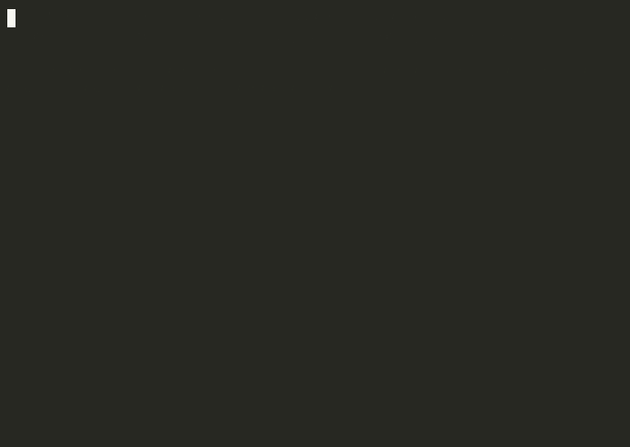

# standbox

> **Describe a sandbox in plain English. Get a per-agent permission gate +
> a human-readable report for any CLI - no server-side changes.**



*<sub>If the gif doesn't render, run `make-demo.sh` to regenerate it.</sub>*

---

## What it does

You want to hand an AI agent a powerful CLI, but not all of it. You write the
policy in English, standbox writes the enforcement.

```
kubectl:     only namespace mfsada, CRUD on pods and deployments,
             port-forward allowed, no jobs but cronjobs ok, no secrets

git:         read-only: status, log, diff. no push, no commit, no reset

terraform:   plan, validate, state list only. no apply, no destroy, no -auto-approve

psql:        read-only SQL. allow SELECT, WITH, SHOW. deny DROP, DELETE, INSERT

docker:      no persistent mounts, no privileged, read-only rootfs

npm:         run, ls, view, audit. no install, no publish, no exec
```

For each one you get:

1. **A gate** (`bundles/<name>/<cli>/gate/<cli>`) - a deterministic bash script
   that sits first on PATH and blocks anything outside the policy. Verb,
   subcommand, resource, namespace, flags, and shell metacharacters are all
   checked. No LLM at runtime.
2. **A report** (`bundles/<name>/sandbox.md`) with:
   - **use cases TESTED against the gate** - each row is a real gate run,
     ALLOW or BLOCK with the reason,
   - **what it CANNOT do**,
   - **ONE command** to run it in a container where the gated binary is the
     only one on PATH,
   - an honest section separating the gate (real enforcement) from the stub
     target (show-only) and real mode (mount your real binary).

### Demo

<a href="docs/standbox-demo.gif"></a>

Generate, read the tested table, watch the gate allow and block, get the
container command. Same flow for every CLI.

---

## Why this exists

Server-side RBAC needs admin rights and a cluster you control. Prompting an
LLM with "be careful" is not enforcement. standbox puts the policy on your
machine, enforced by a generated script, and records what happened.

- **Not** a system sandbox (no seccomp, no namespaces).
- **Is** a policy gate on the natural path: whatever you or your agent types
  goes through the gate first.

---

## How a new CLI gets supported

The engine is CLI-agnostic. Each CLI is described by one schema dict in
`standbox/schema.py`:

| Field | Purpose |
|---|---|
| `arg_model` | how arguments are shaped: `verb_resource_name`, `subcommand`, `flags_inject`, `sql` |
| `verbs` / `subcommands` | what can be allowed |
| `resources` | resource nouns (kubectl-style CLIs) |
| `hard_deny` | flags that are never allowed regardless of policy (`--raw`, `-A`, `-auto-approve`, `--privileged`) |
| `namespace_flags` | how namespace scope is expressed (`-n`, `--namespace`, `-A`) |

Four arg models cover the shapes we've hit so far:

- **verb_resource_name** - `kubectl get pods`, `docker ps`
- **subcommand** - `gh pr list`, `terraform plan`, `aws s3 ls` (nested tokens)
- **flags_inject** - `docker run` with enforced flags injected
- **sql** - statement-level allow/deny for `psql`

Shipped schemas: kubectl, docker, git, gh, aws, terraform, helm, npm, gcloud,
psql.

**This is hand-written grammar, not `--help` scraping.** standbox does not run
`<cli> --help` and infer the grammar. If your CLI isn't in the list, add a
dict - about 20 lines - or pass explicit `constraints` JSON.

---

## Threat model (honest)

standbox enforces the **natural path**: the CLI invoked by name, through the
gate.

It does **NOT** stop:
- the absolute path (`/usr/local/bin/<cli>`), which skips the gate,
- `curl` or a library talking to the same API with your credentials,
- an agent with your file access reading real credentials directly,
- a hostile process running as your user.

Container mode narrows this: the image contains only the gated binary, so
`/usr/local/bin/<cli>` *is* the gate. Real mode (bind-mounting your binary and
credentials) reopens the caveat, and the generated report says so.

See [SECURITY.md](SECURITY.md).

---

## Install

```bash
pip install .
# dependencies: mcp>=1,<2 ; pyyaml
```

### Register with Claude Code (MCP)

```jsonc
// .mcp.json (project) or ~/.claude.json (user)
{
  "mcpServers": {
    "standbox": {
      "command": "python",
      "args": ["-m", "standbox.mcp_server"],
      "env": { "PYTHONDONTWRITEBYTECODE": "1" }
    }
  }
}
```

---

## Quick start

```bash
# 1. in Claude Code, generate a sandbox for any CLI
#    /standbox terraform: plan and validate only, no apply, no destroy

# 2. read the report
cat bundles/agent/sandbox.md

# 3. run the gate locally
export PATH="$PWD/bundles/agent/terraform/gate:$PATH"
terraform plan        # ALLOWED
terraform apply       # BLOCKED with reason

# 4. or in a container where the gated binary is the only one
bash bundles/agent/terraform/container/run.sh
```

---

## Architecture

```
 natural language "use case"
        │
   ┌────▼─────┐   schema.py (per-CLI grammar data)
   │ MCP tool │──► constraints {verbs, subcommands, resources, namespaces, deny}
   │ generate │
   └────┬─────┘
        ├──► gate script (deterministic bash policy, hard-denies)
        ├──► policy.yaml  +  container/ (Dockerfile, run.sh, staged gate)
        ├──► sandbox.md   (use cases TESTED - each row a real gate run)
        └──► audit.jsonl  (ts, sandbox, command, verdict, reason)
```

Enforcement is a generated script, never an LLM. The LLM only drafts the
constraints from your English; you can pass exact `constraints` JSON to skip
the naive parser.

---

## MCP tools

| Tool | What it does |
|---|---|
| `standbox_generate(use_case, cli, name?, constraints?)` | Build the bundle + report |
| `standbox_check(command, sandbox)` | Dry-run: ALLOW/BLOCK + reason (audited) |
| `standbox_audit(sandbox, limit?, blocked_only?)` | Real audit trail |
| `standbox_list()` | Which sandboxes exist |
| `standbox_parse(use_case, cli)` | Preview parsed constraints |

---

## Demo script

```bash
brew install asciinema agg
./make-demo.sh            # writes docs/standbox-demo.gif
```

---

## Status

v0.1.0. Not yet: `--help` scraping, signed gates, Windows support. Container
ships a stub target by default; real mode mounts a Linux binary at
`/usr/local/bin/<cli>.real` (see the generated report).

## License

[MIT](LICENSE)

## Security

[SECURITY.md](SECURITY.md)
